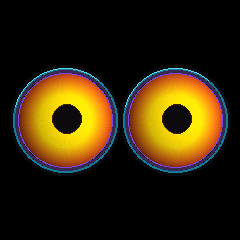

# Eyes auf GC9A01

Zwei lebendige Augen auf **einem** runden 1,28-Zoll-Display. Dieses Projekt
enthält die aktuell auf dem Raspberry Pi laufende Version, eine Browsersteuerung
und den Simulator. Das Display ist ein SPI-TFT mit GC9A01-Treiber und 240 × 240
Pixeln. Die ESP32-C6-Firmware ist noch nicht Teil dieses Releases.



## Hardware

- Raspberry Pi 3B+ mit Raspberry Pi OS Lite (64 Bit)
- Rundes GC9A01-Display, 1,28 Zoll, 240 × 240 Pixel, SPI
- Kurze Verbindungskabel
- Empfohlenes Netzteil: 5 V / 2,5 A

Die Pinbelegung entspricht dem getesteten Display. Signalnamen auf GC9A01-
Modulen können abweichen; insbesondere heißt MOSI auf manchen Modulen `SDA`.

| Display | Raspberry Pi BCM | Physischer Pin |
| --- | --- | --- |
| VCC | 3,3 V | 1 |
| GND | Masse | 6 |
| SCL / SCLK | GPIO 11 / SPI0 SCLK | 23 |
| SDA / MOSI | GPIO 10 / SPI0 MOSI | 19 |
| CS | GPIO 8 / SPI0 CE0 | 24 |
| DC | GPIO 25 | 22 |
| RST | GPIO 27 | 13 |

## Installation auf Raspberry Pi OS Lite

SPI einschalten und den Pi neu starten, falls `/dev/spidev0.0` noch fehlt:

```sh
sudo raspi-config nonint do_spi 0
sudo reboot
```

Lade danach das Projekt herunter und installiere den Daemon:

```sh
cd eyes-on-gc9a01/raspberry
sudo ./install.sh
```

Der Installer lädt die Python-Bibliotheken aus Raspberry Pi OS, kopiert den
Daemon nach `/opt/uncanny-eyes` und aktiviert den `systemd`-Dienst. Der Dienst
startet nach jedem Neustart automatisch. Die vorhandene Konfiguration auf dem
Pi wird bei Updates nicht überschrieben.

```sh
sudo systemctl status uncanny-eyes
sudo journalctl -u uncanny-eyes -f
```

## Websteuerung

Im Browser `http://<IP-des-Raspberry-Pi>:8080` öffnen. Dort kann man zwischen
einem großen Auge und zwei Augen umschalten, den Wanderblick und die Pupillengröße
ändern oder ein Blinzeln auslösen. Die Einstellungen bleiben auf dem Pi
gespeichert.

Port 8080 ist für das private Heimnetz gedacht. Bitte nicht ins Internet
weiterleiten.

## Konfiguration und Download

`raspberry/config.json` enthält SPI-Takt, GPIOs, Bildfrequenz und Startansicht.
Bei Bildfehlern den SPI-Takt testweise von 32 MHz auf 16 MHz senken.

Der Daemon besteht aus `raspberry/eyes.py`, `raspberry/display.py`,
`raspberry/control.html`, `raspberry/config.json` und
`raspberry/uncanny-eyes.service`. Auf GitHub kann das gesamte Projekt über
**Code → Download ZIP** heruntergeladen werden; einzelne Dateien liegen im
Ordner `raspberry/`.

## Simulator und Version 1.0

`simulator/index.html` direkt im Browser öffnen. Der Simulator läuft lokal und
braucht weder Raspberry Pi noch Display. `versions/v1.0/index.html` sichert den
Stand vor den späteren Anpassungen für zwei Augen.

## GC9A01-Treiber

Die Display-Initialisierung folgt dem Waveshare-Treiber `LCD_1inch28.py` aus
[acromtech/Waveshare-1.28inch-LCD-Module-animated-eyes](https://github.com/acromtech/Waveshare-1.28inch-LCD-Module-animated-eyes/blob/cd0e603542506fddecf83d3937c6ffb5d25e9a74/lib/LCD_1inch28.py),
Commit `cd0e603542506fddecf83d3937c6ffb5d25e9a74`. Waveshare wird im Original
als Urheber genannt und der Treiber ist MIT-lizenziert; die Hinweise dazu
stehen auch in [`raspberry/README.md`](raspberry/README.md).

## ESP32-C6

Die Augen laufen aktuell auf dem Raspberry Pi. Eine Arduino-/ESP32-C6-Version
ist noch nicht erstellt oder getestet. Simulator und Pi-Animation dienen als
Vorlage für eine spätere Portierung.

## Ausblick

Als nächstes ist ein passendes, 3D-druckbares Gehäuse für Display und Elektronik geplant. Dazu soll ein Näherungssensor kommen, der erkennt, wenn sich jemand dem kleinen Schreibtisch-Wesen nähert. Über Home Assistant könnten solche Ereignisse dann eine passende Reaktion der Augen auslösen. Gehäuse, Sensor und Home-Assistant-Anbindung sind noch in Planung und nicht Bestandteil der aktuellen Version.
